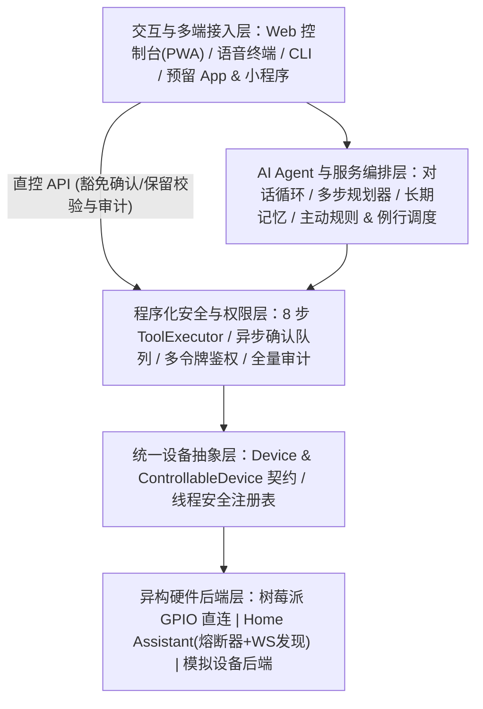
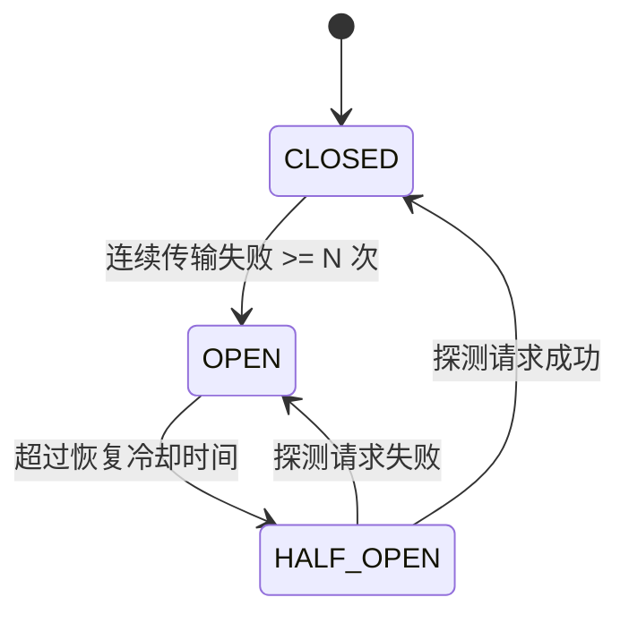

# 毕业设计（论文）开题报告

> **课题名称**：基于树莓派与大语言模型的边缘多模态智能家居控制系统设计与实现  
> **所属专业**：软件工程  
> **课题定位**：`Python + 树莓派 + 大语言模型，智能家居控制方向`  
> **文档版本**：V1.0（已结合本地与树莓派实机部署验证结果编写）

---

## 一、选题背景与研究意义

### 1.1 选题背景
随着物联网（IoT）与人工智能技术的深度融合，智能家居正从“手机 App 手动点控 + 固定规则触发”向“自然语言理解 + 场景化自主决策”演进。大语言模型（Large Language Model, LLM）凭借强大的意图理解、工具调用（Function Calling）与多步任务规划能力，为家庭人机交互带来了全新的范式。

然而，将大语言模型直接引入物理智能家居控制领域仍面临四大工程挑战：
1. **安全性与幻觉风险**：LLM 属于概率生成模型，易受提示注入、参数幻觉或状态误判影响。若仅依赖系统提示词（System Prompt）进行安全约束，可能导致越权操作门锁/燃气等高风险设备，或在设备离线、控制失败时谎报“执行成功”。
2. **硬件异构与生态割裂**：家庭设备既包含树莓派 40-pin GPIO 直连的传感与执行外设（LED、继电器、PWM 风扇、DHT 温湿度、PIR 人体感应），又包含 Home Assistant（HA）、ESP32/ESPHome 等局域网生态设备，缺乏统一抽象会导致业务逻辑与底层协议深度耦合。
3. **边缘算力受限与可靠性不足**：树莓派作为家庭边缘网关（ARM64、低功耗），本地难以承载大模型与重算力神经语音合成；同时当底层 HA 平台宕机或语音服务离线时，传统串联调用容易引发请求超时雪崩与界面假死。
4. **多端协同与隐私隔离缺失**：家庭场景存在多成员共用、PC/Web/移动端（App 与微信小程序）多端接入需求，既需要统一的安全鉴权与设备直控接口，又需要在端侧保护成员个人记忆与声纹隐私。

### 1.2 研究意义
- **工程实践意义**：本课题立足软件工程思想，遵循“不重复造 Home Assistant、不做只会聊天的 Demo”的工程原则，探索**用确定性的软件工程机制约束不确定的大模型输出**，在树莓派边缘节点上构建集多模态感知、安全执行、容错降级、可观测控制台与多端预留接口于一体的完整软硬闭环系统。
- **应用价值**：通过“端侧轻量化感知与直控 + 云端大模型推理”的云边协同架构，显著降低家庭智能化部署成本与响应延迟，同时通过标准化配对协议与直控 API 为后续 Android/iOS App 及微信小程序提供平滑接入底座。

---

## 二、国内外研究现状与发展趋势

### 2.1 开源智能家居平台现状
国外以 **Home Assistant** 与 **OpenHAB** 为代表的开源平台已形成成熟的设备驱动与自动化生态，支持数千种物联网协议，并推出 ESPHome 降低 ESP32 自定义硬件开发门槛；国内则以米家、华为鸿蒙智联等商业生态为主，但商业平台普遍封闭、强依赖云端且难以深度定制 AI Agent 安全策略。

### 2.2 大语言模型与智能体（Agent）控制研究
近年来，学术界与工业界围绕 ReAct 推理框架、OpenAI Function Calling 工具协议与多步任务规划（Task Planning）展开了大量研究，出现了一批基于 LLM 的智能家居对话原型。但现有研究与开源原型大多存在以下不足：
- 多数停留在仿真文本演示阶段，缺乏真实嵌入式硬件（如树莓派 GPIO/传感器）的物理回读闭环；
- 安全控制主要依赖 Prompt 约束，缺少独立于大模型的程序化白名单、防重放、交互式确认队列与审计追踪机制；
- 缺少面向边缘网关故障的容错设计（如适配器熔断器、语音主备降级与 Token 成本熔断）。

### 2.3 边缘多模态交互趋势
随着 ONNX Runtime、Whisper 量化推理（`faster-whisper`）与轻量级关键词唤醒（`sherpa-onnx` KWS）的发展，在树莓派 ARM64 CPU 上运行离线中文唤醒与语音识别已成为现实。将轻量化感知下沉至边缘侧、重算力推理按需协同的架构，正成为边缘智能家居的主流技术路线。

---

## 三、研究目标与主要研究内容

### 3.1 研究目标
设计并实现一套部署于树莓派边缘节点的**安全可控、面向异构硬件、支持多模态交互与多端扩展**的 AI 智能家居控制系统，完成从自然语言/语音/Web 直控到实体外设动作与状态回读验证的全链路工程闭环，并开展系统的自动化测试与量化性能评估。

### 3.2 主要研究内容

1. **面向边缘算力受限场景的云边协同多模态交互架构**
   - 端侧集成文本 CLI、现代化响应式 Web 控制台（支持 PWA）、离线中文唤醒词（`sherpa-onnx`）与本地语音识别（`faster-whisper`），结合环境传感器数据构成多模态输入；
   - 输出层支持可配置 TTS 后端（`CosyVoice` 授权音色克隆 / 端侧 `SAPI/espeak` 自动降级）与基于声纹向量的家庭成员识别，实现按成员隔离的 SQLite 长期记忆（未识别说话人仅访问家庭共享记忆）。

2. **面向异构硬件的统一设备抽象与三轨后端接入机制**
   - 设计统一的 `Device / ControllableDevice` 抽象契约与线程安全设备注册表，使上层 Agent 与工具层与底层协议零耦合；
   - 实现三轨可插拔后端：树莓派 40-pin **GPIO 直连后端**（支持 LED/PWM 调光、三档风扇、继电器、DHT 温湿度、DS18B20、PIR 人体感应）、**Home Assistant 后端**（支持 REST/WebSocket 自动发现与区域同步）及**模拟设备后端**（供离线开发与回归测试）；
   - 在 HA 适配器中引入 **HTTP 连接池与三态熔断器（`CLOSED / OPEN / HALF_OPEN`）**，防止平台宕机时引发逐台设备超时阻塞。

3. **程序化安全执行流水线与多步任务规划机制**
   - 构建独立于大模型提示词的 **8 步程序化安全执行器**（`ToolExecutor`）：工具白名单检查 → JSON 解析 → Schema 强类型校验 → 风险分级拦截（高风险域结构性排除）→ 3 秒防重放保护 → 异步用户确认队列（超时自动拒绝）→ 带超时执行与只读重试 → 状态回读验证与审计落库；
   - 实现多步任务规划器（`PlanRunner`），支持服务端计划预检、顺序执行、遇错中止与任务日志持久化，并支持多模型角色路由（`main` / `planner`）与每日 Token 预算控制；
   - 构建基于确定性规则引擎的主动提醒服务与预授权例行任务调度器。

4. **面向 Web / App / 微信小程序的多端解耦接口与可观测控制台**
   - 设计并预留标准化 RESTful + SSE 服务端接口：公开健康探针（`/api/health`）、能力发现（`/api/system/info`）、基于 6 位一次性配对码与 SHA-256 令牌哈希的**多令牌配对协议**（`/api/pair/*`，支持 App 与小程序接入及即时踢除）、**设备直控 API**（`/api/devices/{id}/command`，复用安全执行器并区分审计主体 `web_direct` / `device_app`）、AI 人设热生效接口（`/api/settings/persona`）；
   - 重构并美化 Web 控制台，采用零外部 CDN 依赖的模块化前端架构，实现按区域动态渲染设备控件、基于 SSE 的 **8 步安全流水线实时可视化**、例行任务管理、安全审计台账与多端配对中心。

---

## 四、总体技术方案与系统架构设计

### 4.1 技术选型
| 层次 | 技术选型 | 选型理由 |
|---|---|---|
| 边缘硬件与 OS | Raspberry Pi 4B/5（ARM64，Debian / Raspberry Pi OS） | 低功耗 7×24 运行，具备 40-pin GPIO 与完整 Linux 生态 |
| 后端服务框架 | Python 3.11+、FastAPI、Uvicorn、Pydantic | 原生异步 SSE 支持、AI 生态完善、轻量适合边缘端 |
| 数据持久化 | SQLite（WAL 模式，分库 `memory.db` / `household.db`） | 单文件零运维、线程安全、支持记忆/规则/例行/审计/配对表 |
| 大模型接入 | OpenAI 兼容协议 + 命名多模型档案（默认 DeepSeek） | 屏蔽厂商差异，支持主模型与规划模型分离配置 |
| 硬件接入 | `gpiozero`（GPIO 直连）+ `httpx` 连接池/熔断器（HA）+ ESPHome | 统一抽象契约，兼顾本地直连与局域网生态 |
| 前端与多端预留 | 原生模块化 HTML5/CSS3/ES6 + PWA + CORS + Bearer 多令牌 | 零构建依赖、树莓派离线直出，天然平滑对接 Capacitor App 与微信小程序 |

### 4.2 五层逻辑架构图

### 4.3 8 步安全执行流水线设计

### 4.4 HA 适配器三态熔断状态机

### 4.5 核心数据库表设计（SQLite）
- `memories`：存储用户偏好与事实，含 `source`（`user` / `inferred`）与 `member_id`（实现成员隐私隔离）；
- `routines` / `proactive_rules` / `notifications`：持久化预授权例行任务、确定性主动规则与提醒记录；
- `task_logs` / `audit_log` / `token_usage`：记录多步任务轨迹、全主体安全审计日志与每日 Token 消耗；
- `pairings` / `settings`：持久化已配对 App/小程序设备信息（仅存令牌 SHA-256 哈希，不落明文）与系统个性化配置（如 AI 人设）。

---

## 五、拟解决的关键问题与创新点

1. **关键问题一：如何防止大语言模型幻觉与提示注入导致物理设备误控？**
   - **解决方案**：在架构层将安全边界下沉至独立代码执行器（`ToolExecutor`），结构性排除门锁/燃气等高风险域，对控制类操作强制走“异步确认 + 执行后状态回读验证”，明确区分 `ok / error / declined / unknown` 四态，杜绝“盲报成功”。
2. **关键问题二：如何在异构硬件与外部依赖异常时保障树莓派边缘节点的高可用性？**
   - **解决方案**：面向接口抽象出三轨可插拔后端；在 HA 适配器中实现三态熔断器与连接池复用，在语音层实现 `FallbackSpeaker` 故障降级，确保任一外部服务异常时不拖垮主控进程。
3. **关键问题三：如何实现面向 Web、App 与微信小程序的统一安全接入与实时可观测？**
   - **解决方案**：设计 6 位一次性配对码与多令牌鉴权机制，提供设备直控 API 与 SSE 实时安全流水线推送，使审计日志精确区分 `agent`、`web_direct` 与 `device_app:<id>` 主体。

---

## 六、系统测试与量化实验设计（对应论文第 5 章）

1. **离线自动化回归测试**：基于依赖注入（`FakeLLM` + 模拟设备 + 进程内 HA 模拟器），编写覆盖安全流水线、多步规划、GPIO 后端、熔断器、多令牌配对、直控 API 与记忆隔离的 `pytest` 回归套件（当前已通过 350+ 项测试用例）并配置 GitHub Actions CI。
2. **安全对抗与抗幻觉实验**：构造未注册工具调用、非法参数注入、诱导控制高风险设备、设备离线/回读失败等对抗测试集，对比“纯 Prompt 约束”与“本系统程序化执行器”的拦截率与误报率。
3. **树莓派实机边缘性能与容错实验**：在树莓派（`aarch64`）实机上测试 GPIO 直连控制端到端延迟、HA 宕机场景下引入熔断器前后的接口响应时间对比、以及前端 SSE 实时流水线推送延迟。
4. **多模型路由与成本评估**：对比单模型与 `main + planner` 分工模式在多步场景任务中的成功率、工具调用轮次与 Token 消耗。

---

## 七、进度安排与里程碑计划

| 阶段 | 时间周期 | 主要工作内容 | 阶段成果 |
|---|---|---|---|
| 第一阶段 | 第 1–2 周 | 调研文献、明确需求分析、完成开题报告与总体架构设计 | 开题报告、需求与架构文档 |
| 第二阶段 | 第 3–5 周 | 核心 Agent、安全执行器、三轨设备后端（含树莓派 GPIO 与 HA 熔断器）开发与单元测试 | 后端核心代码与离线测试集 |
| 第三阶段 | 第 6–8 周 | 多端配对协议、设备直控 API、SSE 安全流水线与 Web 控制台重构美化 | 完整 Web 控制台与 API 文档 |
| 第四阶段 | 第 9–11 周 | 树莓派硬件联调与部署测试，拓展移动端 App / 微信小程序客户端接入 | 树莓派实机演示环境与多端原型 |
| 第五阶段 | 第 12–13 周 | 开展安全对抗、熔断容错与边缘性能量化实验，汇总图表数据 | 第 5 章实验数据与测试报告 |
| 第六阶段 | 第 14–16 周 | 撰写毕业论文初稿、绘制 UML/ER/架构图、查重修改与答辩演练 | 毕业论文终稿与答辩 PPT |

---

## 八、主要参考文献

[1] Yao S, Zhao J, Yu D, et al. ReAct: Synergizing Reasoning and Acting in Language Models[C]//Proceedings of the 11th International Conference on Learning Representations (ICLR). 2023.  
[2] Schick T, Dwivedi-Yu J, Dessì R, et al. Toolformer: Language Models Can Teach Themselves to Use Tools[C]//Advances in Neural Information Processing Systems (NeurIPS). 2023, 36.  
[3] Nygard M T. Release It!: Design and Deploy Production-Ready Software[M]. 2nd ed. Raleigh: Pragmatic Bookshelf, 2018.  
[4] Home Assistant Contributors. Home Assistant Architecture & REST/WebSocket API Documentation[EB/OL]. https://developers.home-assistant.io/, 2025.  
[5] Radford A, Kim J W, Xu T, et al. Robust Speech Recognition via Large-Scale Weak Supervision[C]//Proceedings of the 40th International Conference on Machine Learning (ICML). 2023: 28492-28518.  
[6] Du Z, Chen Q, Zhang S, et al. CosyVoice: A Scalable Multilingual Zero-shot Text-to-speech Synthesizer based on Supervised Semantic Tokens[J]. arXiv preprint arXiv:2407.05407, 2024.  
[7] 王鹏, 李明. 基于边缘计算的智能家居网关架构设计与实现[J]. 计算机工程与应用, 2023, 59(14): 245-252.  
[8] 张伟, 陈晓. 面向大语言模型智能体的工具调用安全与权限控制研究综述[J]. 软件学报, 2024, 35(10): 4612-4634.  
[9] Fowler M. Patterns of Enterprise Application Architecture & Circuit Breaker Pattern[EB/OL]. https://martinfowler.com/bliki/CircuitBreaker.html, 2024.  
[10] Bass L, Clements P, Kazman R. Software Architecture in Practice[M]. 4th ed. Boston: Addison-Wesley, 2021.
