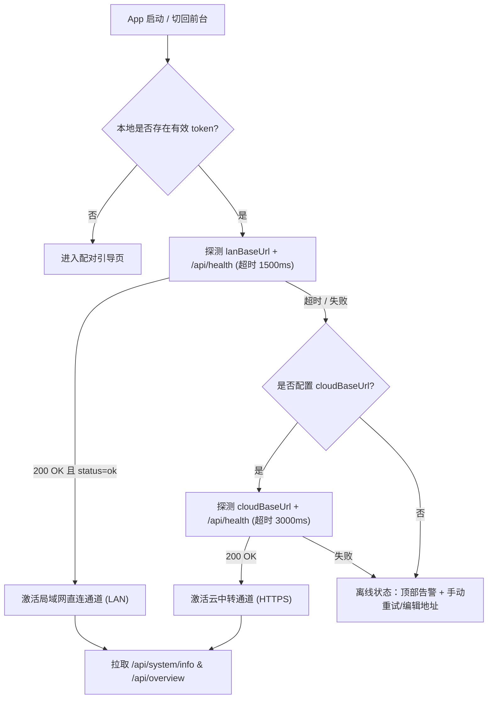
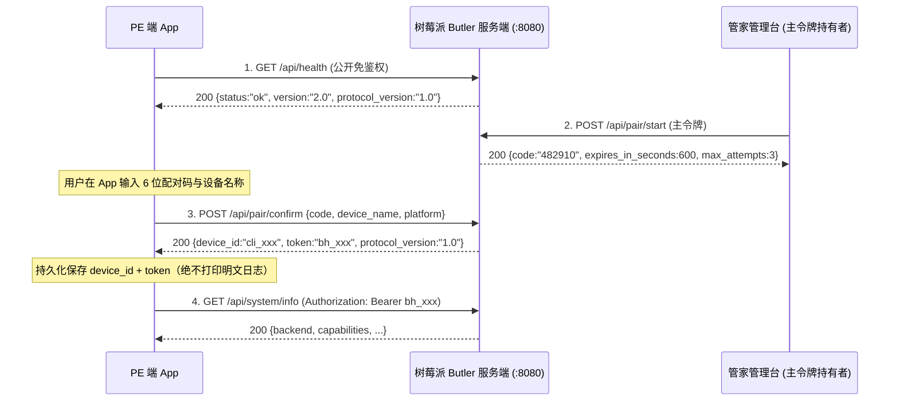

# AI Home Butler — PE 端（移动端）App 产品与技术架构设计文档

> **文档版本**：V1.0  
> **目标受众**：下游构建智能体 / 移动端研发工程师（可直接依据本文档完成端到端实现）  
> **对接后端**：`AIHomeButler` 服务端 V2.0（FastAPI，协议版本 `1.0`，默认端口 `8080`）  
> **核心理念**：树莓派管家服务端是唯一权威“大脑”，PE 端 App 是它的**移动遥控器 + AI 对话终端 + 安全审批端 + 配置台**；设备直控不经 AI（毫秒级响应），复杂场景交由 AI 对话与规划，全部动作共用同一套安全与审计边界。

---

## 1. 产品定位、边界与技术选型

### 1.1 职责边界（务必遵守）
- **App 负责**：局域网/云端双通道连接、一次性 6 位配对码绑定、按动态能力渲染设备直控卡片、AI 自然语言对话与多步任务下达、实时接收并审批高敏/设备控制确认请求、例行任务/记忆/人设管理与安全审计查看。
- **App 明确不做（Non-Goals）**：
  - 不在手机本地运行任何大模型、ASR 或 TTS 推理；
  - 不直连树莓派 GPIO 或 Home Assistant（所有设备读写必须经由 Butler 服务端 API）；
  - 不绕过服务端高风险设备限制（`lock` / `alarm` / `siren` / `water_heater` 由服务端结构性禁止，直控返回 `403`）；
  - 绝不将「操作确认」做成系统通知栏一键静默批准按钮——用户必须打开 App 看清摘要与完整参数后手动点选「批准」或「拒绝」。

### 1.2 技术栈选型建议
为兼顾 **Android APK、iOS（PWA / 原生壳）以及后续微信小程序** 的最大代码复用，推荐以下两套方案（默认按**方案 A** 给出工程目录与实现规范，构建智能体也可按团队要求切换至方案 B，全部 API 契约与页面逻辑 100% 通用）：

| 维度 | 方案 A（首选）：**uni-app (Vue 3 + TS + Pinia + Vite)** | 方案 B（纯原生）：**Flutter 3.24+ (Dart + Riverpod + Dio)** |
|---|---|---|
| 跨端能力 | 一套代码同步编译 **Android APK / H5(PWA) / 微信小程序** | Android APK / iOS 原生体验极佳（不支持微信小程序） |
| 实时通信 | App/H5 支持 SSE 流；小程序端自动降级为分级短轮询 | 原生 `http`/`dio` 流式读取 SSE，体验流畅 |
| 安全存储 | App 端用 `plus.storage` / 原生 Keystore 插件；小程序用加密存储 | `flutter_secure_storage`（Android Keystore / iOS Keychain） |
| 适用场景 | **需要同时产出 App + 微信小程序** | 专注纯移动端原生流畅度与复杂动效 |

---

## 2. 系统连接架构与配对状态机

### 2.1 双通道自动切换（LAN 优先 → Cloud 兜底）



### 2.2 局域网首次配对流程（对齐服务端 `PairingManager`）



### 2.3 鉴权与异常收敛规则
- **请求头约定**：所有受保护接口统一携带 `Authorization: Bearer <token>`（服务端同时兼容 `X-Butler-Token: <token>`；SSE 连接支持 `?token=<token>`）。
- **令牌失效处理（`401`）**：任一接口返回 `401` 时，立即停止 SSE/轮询，清除本地 `token`，提示“设备凭证已失效或被管理员解绑，请重新配对”，并路由至配对页。
- **权限边界（`403`）**：已配对客户端令牌为普通设备令牌（`is_primary_token = false`），**不可**调用 `POST /api/pair/start` 或 `DELETE /api/pair/devices/{id}`（服务端返回 `403`）；App 端「设置 → 已配对设备」默认只读展示，仅在使用主令牌调试时显示配对码生成与踢除按钮。

---

## 3. 完整信息架构与页面交互设计

### 3.1 导航结构
- **底部 4 Tab 导航栏**：
  1. `首页`（设备直控与环境总览）
  2. `管家`（AI 对话、多步规划与实时安全流水线）
  3. `自动化`（例行任务、主动提醒与生活台账）
  4. `我的`（长期记忆、AI 人设、审计日志与连接设置）
- **全局悬浮安全审批抽屉（Global Confirmation BottomSheet）**：
  - 挂载在根布局，**在任意 Tab 下均可即时弹出**；
  - 只要存在待确认项（`confirmations.length > 0`），底部 Tab「管家」图标右上角显示琥珀色角标，同时弹出审批卡片：
    - 标题：`⚠️ 待批准的安全操作`
    - 摘要：`item.summary`（如“控制设备 light.desk_lamp：turn_on”）
    - 参数明文区：等宽字体展示格式化后的 `item.arguments`
    - 操作按钮：「✓ 批准执行」（绿色主按钮）与「✕ 拒绝」（红色次按钮），点击后立即置灰防重入，调用 `POST /api/confirmations/{id}`。

### 3.2 Tab 1：首页（设备直控与环境总览）
1. **顶部状态栏**：
   - 左侧：管家标题 + 连接状态胶囊（`🟢 局域网直连` / `🔵 云中转` / `🔴 已断开`）。
   - 右侧：后端徽章（`GPIO` / `HA` / `SIM`）+ 手动刷新图标。
   - **HA 熔断告警横幅**：当 `overview.ha_circuit_breaker?.state === "open"` 时显示醒目橙红提示：“Home Assistant 熔断保护中，约 {retry_after_seconds}s 后自动恢复探测”。
2. **环境传感器横向滚动卡片条**（筛选 `type === "sensor"`）：
   - 兼容多后端字段读取规则（**关键**：务必按以下优先级取值）：
     - 温度：`state.temperature_c ?? state.temperature`（单位 `°C`）
     - 湿度：`state.humidity_percent ?? state.humidity`（单位 `%`）
     - 通用标量：`state.value` + `state.unit`
     - 人体感应：`state.motion_detected ?? state.motion`（显示“有人移动”/“无人”）
   - 新鲜度标记：`state.fresh === false` 显示橙色「数据陈旧」徽章；`available === false` 显示红色「离线」。
3. **区域筛选胶囊**：自动从设备列表提取去重后的 `area`（`全部` + 各区域），切换时客户端本地过滤，响应 0 延迟。
4. **动态能力设备卡片网格（2 列自适应，控制类扩展卡片占 1–2 列）**：
   - 严格依据 `device.actions` 数组动态渲染控件，**禁止按 `device.id` 写死**：
     | 设备类型 `type` | 识别到的 `actions` | 渲染控件与交互细节 |
     |---|---|---|
     | `light` | `turn_on`/`turn_off` | 顶部大开关 Switch；开启态卡片带青蓝色外发光边框 |
     | `light` | 含 `set_brightness` | 展开 1–100% 亮度滑条；**仅在松手（`change`）时发请求**，防连续触发 3s 防重放 |
     | `fan` | `turn_on`/`turn_off` + `set_speed` | 开关 Switch + `低(low) / 中(medium) / 高(high)` 三档分段按钮 |
     | `switch` | `turn_on`/`turn_off` | 简洁高对比度开关 Switch，点击带轻触觉震动反馈 |
     | `cover` | `open`/`stop`/`close`/`set_position` | 三键控制栏（开/停/关）+ 位置百分比滑条（`100`=全开） |
     | `climate` | `turn_on`/`turn_off` + `set_temperature` | 开关 + 当前温度（`current_temperature`）+ `-` / 目标温度 / `+` 步进器 |
     | `humidifier` | `turn_on`/`turn_off` + `set_humidity` | 开关 + 当前湿度 + 目标湿度滑条（0–100%） |
     | `vacuum` | `start`/`pause`/`stop`/`return_to_base` | 状态标签 + 按钮组 + 电池电量（`battery`%） |
   - **直控回读反馈规则**：
     - 接口调用：`POST /api/devices/{device_id}/command`，请求体 `{ action, value? }`（无 `value` 时省略该键）；
     - `status === "ok" && verified === true`：更新本地该设备状态为 `state_after`，Toast 轻提示“已执行并验证”；
     - `stage === "duplicate_skipped"`：轻提示“3 秒内已执行过相同操作”；
     - `status === "unknown"`：弹窗/长 Toast 黄色告警“指令可能已发送，但回读状态未知，请下拉刷新确认”，**不得渲染为成功**；
     - HTTP `400` / `403`：回滚开关 UI 状态，展示服务端返回的 `detail`。

### 3.3 Tab 2：管家（AI 对话、多步规划与实时安全流水线）
1. **顶部模式切换与流水线入口**：
   - 分段切换：`自然语言对话`（`POST /api/chat`）｜`多步骤任务规划`（`POST /api/task`，若 `capabilities.planner === false` 则隐藏）。
   - 右上角胶囊：`🛡️ 安全流水线`（点击展开/折叠实时 8 步安全追踪面板；有工具执行时自动高亮呼吸灯）。
2. **实时 8 步安全流水线面板**（数据源自 SSE `pipeline_step`）：
   - 按固定顺序展示 8 个节点：`register_check`（白名单）→ `json_parse`（JSON解析）→ `schema_validate`（Schema校验）→ `risk_check`（风险拦截）→ `dedup_check`（3s防重放）→ `user_confirm`（用户确认）→ `execute`（超时执行）→ `verify_audit`（回读与审计）。
   - 节点状态着色：`ok`=绿、`pending`=蓝脉冲、`warn`=琥珀、`error`=红、`skipped`=灰。
3. **对话消息流**：
   - 用户消息靠右（品牌渐变底），管家回复靠左（卡片底）；
   - 工具执行摘要（`tool_events`）以可折叠的细标签附着在管家消息上方（`🔧 control_device · ok`）；
   - 多步规划响应（`POST /api/task`）渲染为垂直步骤清单卡片（显示每步 `tool`、`status`、`message` 及最终 `summary`）；
   - 可选语音播报按钮：点击管家气泡旁的喇叭图标，调用 `POST /api/tts` 播放返回的 `audio/wav`（仅当 `capabilities.voice === true` 显示）。
4. **底部输入区**：
   - 横向快捷指令 Chips（如“查室温和设备状态”“睡眠场景”“查看长期记忆”）；
   - 文本输入框 + 发送按钮；请求进行中禁用重复发送，若收到 `409 Conflict` 提示“管家正在处理上一条请求，请稍候”。

### 3.4 Tab 3：自动化（例行任务、主动提醒与生活台账）
顶部三段式 Segmented Control：
1. **例行任务（Routines）**：
   - 列表展示：`name`、`schedule.time`、`schedule.days`（`0..6` 格式化为 `周一..周日`）、`actions` 摘要、`last_result`、启用开关（`POST /api/routines/{id}/toggle`）、删除按钮（`DELETE /api/routines/{id}`）。
   - 新建表单（底部弹窗）：输入任务名、时间选择器（`HH:MM`）、周期选择（**严格传 `daily` / `weekdays` / `weekend` 或整数数组 `[0..6]`，切勿传 `weekends`**）、从当前可控设备列表中选 `device_id` 及对应 `supported_actions` 里的动作（最多 10 步）、调用 `POST /api/routines`。
2. **主动提醒与监测规则**：
   - 通知列表（`GET /api/notifications`）：按 `level`（`info` / `warning` / `error`）着色边框，展示 `rule_name`、`created_at`、`message`。
   - 规则列表（`GET /api/rules`）：只读展示确定性规则名称、类型（`sensor_threshold` / `device_offline` / `schedule`）与开关状态。
3. **生活台账**（仅 `capabilities.household === true` 显示）：
   - **食材库存**（`GET /api/pantry`）：按剩余天数升序展示，`expired === true` 标红、`days_left <= 2` 标橙；
   - **衣柜台账**（`GET /api/wardrobe`）：展示衣物名、归属成员、类别、保暖度、穿着次数与洗涤间隔。

### 3.5 Tab 4：我的（记忆、人设、审计与系统设置）
1. **长期记忆管理**（`GET/POST/DELETE /api/memories`）：
   - 区分 `preference`（偏好）与 `fact`（事实）标签，标注来源 `source`（`user` / `inferred`）与归属（`member_id` 为空显示“家庭共享”）；支持新增与物理删除。
2. **管家 AI 个性化人设**（`GET/PUT /api/settings/persona`）：
   - 一键应用服务端返回的 `presets` 模板胶囊，或自由编辑自定义提示词（限制 ≤ 1000 字），点击保存即热生效。
3. **安全审计与用量看板**：
   - **今日 Token 预算**：读取 `overview.token_budget`（`used_today` 与 `enabled ? limit : 0`），渲染进度条；
   - **模型档案只读卡片**（`GET /api/settings/models`）：展示 `main` / `planner` 模型名、`base_url` 与脱敏 `api_key_masked`；
   - **审计日志列表**（`GET /api/audit?limit=100`）：按 `actor` 彩色标签区分 `agent`、`web_direct`、`device_app:*`、`user`，支持按状态筛选；
   - **语音与声纹状态**（按 `capabilities.voice` / `capabilities.speakers` 展示只读状态，注意声纹开关字段为 `speaker_recognition`）。
4. **连接与多端管理**：
   - 展示当前连接地址（LAN / Cloud）、`device_id`、修改云中转 URL、暗黑/明亮主题切换、「退出并清除本地凭证」。

---

## 4. 后端 API 完整契约与 TypeScript 类型定义

> 以下接口与字段均已对照 `butler/webapp.py`、`butler/devices/*`、`butler/memory/store.py` 逐行核验，构建智能体可直接作为 `src/types/api.ts` 使用。

### 4.1 端点速查表

| 分类 | 方法与路径 | 鉴权 | 说明 |
|---|---|---|---|
| 健康探针 | `GET /api/health` | 公开 | 双通道切换探活与协议版本校验 |
| 系统能力 | `GET /api/system/info` | Bearer | 获取后端类型、能力位 `capabilities`、HA 熔断状态 |
| 仪表盘总览 | `GET /api/overview` | Bearer | 设备列表 + 模型 + 确认模式 + Token 预算 + 熔断状态 |
| 实时事件流 | `GET /api/events?token=...` | Query/Bearer | SSE 事件流（`connected`/`pipeline_step`/`confirmation_*`/`device_updated`/`notification`） |
| 设备列表 | `GET /api/devices` | Bearer | 全量设备视图（含 `actions` 与 `state`） |
| 单设备状态 | `GET /api/devices/{device_id}/state` | Bearer | 刷新单台设备最新状态 |
| **设备直控** | `POST /api/devices/{device_id}/command` | Bearer | 请求 `{action, value?}`，跳过确认、保留校验/防重放/回读/审计 |
| AI 对话 | `POST /api/chat` | Bearer | 请求 `{text}`，阻塞等待（含确认等待），并发冲突返回 `409` |
| 多步规划 | `POST /api/task` | Bearer | 请求 `{text}`，返回计划执行报告，并发冲突返回 `409` |
| 待确认列表 | `GET /api/confirmations` | Bearer | 轮询兜底待批准操作队列 |
| 审批确认 | `POST /api/confirmations/{id}` | Bearer | 请求 `{approved: boolean}` |
| 发起配对 | `POST /api/pair/start` | 主令牌 | 生成 6 位一次性配对码（10 分钟 / 3 次） |
| **确认配对** | `POST /api/pair/confirm` | 公开 | `{code, device_name, platform}` 换取 `{device_id, token}` |
| 已配对列表 | `GET /api/pair/devices` | Bearer | 查看当前生效的已配对客户端 |
| 踢除设备 | `DELETE /api/pair/devices/{device_id}` | 主令牌 | 吊销设备令牌（即时失效） |
| 例行任务 | `GET/POST /api/routines` | Bearer | 列表与创建（`days`：`daily`/`weekdays`/`weekend` 或 `0..6`） |
| 启停/删除例行 | `POST /api/routines/{id}/toggle`、`DELETE /api/routines/{id}` | Bearer | 切换启用状态 / 删除 |
| 提醒与规则 | `GET /api/notifications`、`GET /api/rules` | Bearer | 主动提醒记录与规则清单 |
| 任务日志 | `GET /api/tasks` | Bearer | 历史多步任务记录 |
| 长期记忆 | `GET/POST /api/memories`、`DELETE /api/memories/{id}` | Bearer | 记忆 CRUD（`kind`: `preference` \| `fact`） |
| 家庭台账 | `GET /api/pantry`、`GET /api/wardrobe` | Bearer | 食材库存与衣柜只读视图（未装配返回 `503`） |
| 人设配置 | `GET/PUT /api/settings/persona` | Bearer | 读取预设与当前人设 / 更新人设（≤1000 字） |
| 模型视图 | `GET /api/settings/models` | Bearer | 脱敏模型档案列表（绝不含明文 Key） |
| 审计日志 | `GET /api/audit?limit=100` | Bearer | 最近审计记录（`limit` 范围 1–500） |
| 语音与声纹 | `GET /api/voice/status`、`POST /api/tts`、`GET /api/speakers` | Bearer | 语音状态、文本转 WAV 播放、声纹成员列表（未装配 `503`） |

### 4.2 核心 TypeScript 类型定义（`src/types/api.ts`）

```ts
export type DeviceType =
  | 'sensor' | 'light' | 'fan' | 'switch'
  | 'cover' | 'climate' | 'humidifier' | 'vacuum';

export interface HealthResponse {
  status: 'ok';
  service: string;
  version: string;
  protocol_version: string;
  uptime_seconds: number;
}

export interface CircuitBreakerStatus {
  state: 'closed' | 'open' | 'half_open';
  consecutive_failures: number;
  failure_threshold: number;
  recovery_timeout: number;
  retry_after_seconds: number;
}

export interface SystemInfoResponse {
  version: string;
  protocol_version: string;
  model: string;
  backend: 'simulated' | 'homeassistant' | 'gpio';
  confirmation_mode: 'always' | 'never';
  tts_backend: string;
  uptime_seconds: number;
  ha_circuit_breaker: CircuitBreakerStatus | null;
  paired_devices_count: number;
  capabilities: {
    direct_control: boolean;
    sse_events: boolean;
    pairing: boolean;
    routines: boolean;
    planner: boolean;
    voice: boolean;
    speakers: boolean;
    household: boolean;
  };
}

export interface DeviceState {
  // 开关/亮度/风速/窗帘/温控/加湿/扫地机
  on?: boolean;
  brightness?: number;          // 1-100
  speed?: 'low' | 'medium' | 'high';
  open?: boolean;
  position?: number | null;     // 0-100
  activity?: string;
  hvac_mode?: string;
  current_temperature?: number | null;
  temperature?: number | null;
  humidity?: number | null;
  current_humidity?: number | null;
  status?: string;
  battery?: number | null;
  // 传感器（跨后端兼容字段）
  temperature_c?: number;
  humidity_percent?: number;
  motion_detected?: boolean;
  value?: number | string;
  unit?: string;
  sampled_at?: string;
  fresh?: boolean;
}

export interface DeviceView {
  id: string;
  name: string;
  type: DeviceType;
  area: string;
  available: boolean;
  actions: string[];
  state: DeviceState | null;
}

export interface TokenBudgetStatus {
  enabled: boolean;
  limit: number;
  used_today: number;
  remaining: number;
}

export interface OverviewResponse {
  devices: DeviceView[];
  model: string;
  backend: string;
  confirmation_mode: 'always' | 'never';
  tts_backend: string;
  token_budget: TokenBudgetStatus | null;
  ha_circuit_breaker: CircuitBreakerStatus | null;
}

export interface DirectCommandRequest {
  action: string;
  value?: string | number;
}

export interface DirectCommandResponse {
  device_id: string;
  action: string;
  status: 'ok' | 'unknown' | 'error';
  stage: 'verified' | 'done' | 'duplicate_skipped' | 'unknown' | 'failed';
  message: string;
  verified: boolean;
  state_after: DeviceState | null;
}

export interface PairConfirmRequest {
  code: string;
  device_name: string;
  platform: 'android' | 'ios' | 'miniprogram' | 'pc' | 'web';
}

export interface PairConfirmResponse {
  device_id: string;
  device_name: string;
  platform: string;
  token: string;
  protocol_version: string;
}

export interface ConfirmationItem {
  id: string;
  summary: string;
  arguments: Record<string, unknown>;
  created_at: string;
  approved: boolean;
}

export interface PipelineStepEvent {
  trace_id: string;
  tool: string;
  step:
    | 'register_check' | 'json_parse' | 'schema_validate'
    | 'risk_check' | 'dedup_check' | 'user_confirm'
    | 'execute' | 'verify_audit';
  status: 'ok' | 'warn' | 'error' | 'pending' | 'skipped';
  detail: string;
  actor: string;
}

export interface ChatResponse {
  reply: string;
  tool_events: Array<{ tool: string; status: string; message: string }>;
  notifications: Array<{ id?: number; message: string; level?: string }>;
}

export interface TaskReport {
  status: string;
  steps: Array<{ tool: string; status: string; message?: string }>;
  summary: string;
}

export interface RoutineItem {
  id: number;
  name: string;
  schedule: { time: string; days: number[]; catchup_minutes?: number };
  actions: Array<{ device_id: string; action: string; value?: unknown }>;
  notify_on_success: boolean;
  enabled: boolean;
  last_fired_at: string | null;
  last_result: string;
  created_at: string;
}

export interface MemoryItem {
  id: number;
  kind: 'preference' | 'fact';
  content: string;
  source: 'user' | 'inferred';
  member_id: string | null;
  created_at: string;
  updated_at: string;
}

export interface AuditLogItem {
  id: number;
  created_at: string;
  actor: string;
  action: string;
  detail: string;
  status: string;
}

export interface PersonaResponse {
  persona: string;
  presets: Array<{ id: string; name: string; prompt: string; description: string }>;
}

export interface SpeakersStatusResponse {
  speaker_recognition: boolean;
  threshold: number;
  member_count: number;
  members: Array<{
    member_id: string;
    display_name: string;
    voice_id: string | null;
    created_at: string;
  }>;
  service_healthy: boolean;
  ai_disclaimer: string;
}
```

---

## 5. 实时通信、防重放与网络容错策略

1. **SSE + 分级轮询双模传输**：
   - **H5 / App 端**：使用 `EventSource`（或带 `Authorization` 头的流式客户端）订阅 `/api/events?token=<token>`；断线采用指数退避重连（`2s → 4s → 8s`，上限 `15s`），App 切后台主动断开以省电，切回前台立刻重连并拉取一次 `/api/overview` 与 `/api/confirmations`。
   - **微信小程序端**：因不支持 `EventSource`，通过统一 `RealtimeAdapter` 自动切换为短轮询——对话/任务请求进行期间每 `1s` 轮询 `/api/confirmations`，空闲期每 `4s` 轮询确认与设备状态。
2. **适配服务端 3 秒防重放窗口**：
   - 亮度滑条、窗帘位置滑条仅在用户手指抬起（`touchend` / `@change`）时发送指令；
   - 开关切换按钮增加 `400ms` 请求中 loading 锁，避免连点触发 `STAGE_DUPLICATE_SKIPPED`。
3. **超时预算设置**：
   - `/api/health` 探测超时：`1.5s`（LAN）/ `3s`（Cloud）；
   - 普通 REST 与设备直控：`15s`；
   - `/api/chat` 与 `/api/task`：**至少 `180s`**（因为用户确认队列默认等待最长 `120s`，超时设太短会在用户还没点批准前就断开对话请求！）。

---

## 6. 视觉设计规范（Design Tokens）

延续服务端 Web 控制台的现代化智能家居视觉体系，默认暗黑玻璃态（Dark）并支持一键切换明亮模式（Light）：

```css
/* Dark Theme (Default) */
--bg-page: #090e1a;
--bg-card: rgba(17, 24, 39, 0.84);
--bg-input: #0d1323;
--border-subtle: rgba(148, 163, 184, 0.16);
--text-primary: #f1f5f9;
--text-secondary: #94a3b8;
--brand-primary: #38bdf8;
--brand-gradient: linear-gradient(135deg, #38bdf8, #6366f1);
--status-ok: #34d399;
--status-warn: #fbbf24;
--status-error: #f87171;
--radius-card: 16px;
--radius-control: 10px;
```

- **触控热区**：所有按钮、开关、分段控制项最小点击热区不小于 `44×44 px`；
- **安全区适配**：底部 Tab 栏与全局确认抽屉必须适配 iOS/Android 全面屏底部 `safe-area-inset-bottom`。

---

## 7. 推荐工程目录结构（uni-app Vue 3 + TS）

```text
aihome-butler-mobile/
├── src/
│   ├── manifest.json                # App / 小程序 / PWA 打包配置
│   ├── pages.json                   # 路由与底部 4 Tab 配置
│   ├── types/
│   │   └── api.ts                   # 本文档 §4.2 完整类型定义
│   ├── services/
│   │   ├── storage.ts               # 多端凭证安全存储封装
│   │   ├── connection.ts            # LAN/Cloud 双通道探测与切换器
│   │   ├── http.ts                  # 统一请求封装（Bearer 注入 / 401 拦截 / 超时分级）
│   │   ├── realtime.ts              # SSE（App/H5）+ 分级轮询（小程序）自适应层
│   │   └── butlerApi.ts             # 全量 API 方法封装
│   ├── stores/
│   │   ├── auth.ts                  # 连接地址、device_id、token、通道状态
│   │   ├── devices.ts               # 设备列表、区域聚合、直控乐观更新
│   │   ├── chat.ts                  # 对话流、多步任务、8 步安全流水线状态
│   │   └── confirmation.ts          # 全局待确认队列与审批动作
│   ├── components/
│   │   ├── GlobalConfirmSheet.vue   # 全局安全确认审批抽屉
│   │   ├── DeviceCard.vue           # 动态能力设备直控卡片
│   │   ├── SensorStrip.vue          # 顶部环境传感器横向条
│   │   └── SecurityPipeline.vue     # 8 步安全执行流水线可视化组件
│   └── pages/
│       ├── pairing/index.vue        # 首次连接与 6 位配对码向导页
│       ├── home/index.vue           # Tab 1: 设备直控与总览
│       ├── chat/index.vue           # Tab 2: AI 对话与安全流水线
│       ├── automation/index.vue     # Tab 3: 例行任务 / 主动提醒 / 生活台账
│       └── settings/index.vue       # Tab 4: 记忆 / 人设 / 审计 / 系统设置
└── tests/                           # Vitest 单元测试（双通道切换、传感器字段兼容、状态机）
```

---

## 8. 给构建智能体的实施步骤与验收标准（DoD）

### 8.1 推荐构建顺序
1. **Milestone 1（底座）**：搭建工程脚手架 + `types/api.ts` + `connection.ts`（双通道）+ `http.ts`（含 `401` 拦截与长短超时区分）+ `pairing/index.vue` 配对向导。
2. **Milestone 2（设备直控）**：实现 `SensorStrip` + `DeviceCard` 全 8 类动态控件渲染 + `POST /api/devices/{id}/command` 完整闭环与回读状态提示。
3. **Milestone 3（AI 对话与安全审批）**：实现 `realtime.ts`（SSE/轮询自适应）+ `GlobalConfirmSheet` + `SecurityPipeline` + 对话/多步任务页。
4. **Milestone 4（自动化与设置）**：实现例行任务 CRUD、主动提醒、生活台账只读页、长期记忆管理、AI 人设编辑与安全审计台账。
5. **Milestone 5（联调与打包）**：对接树莓派实机联调，输出 Android 签名测试 APK 与微信小程序构建产物。

### 8.2 验收清单（全部通过方可交付）
- [ ] **配对闭环**：输入局域网地址探测 `/api/health` 成功 → 输入 6 位配对码换取 `bh_` 令牌 → 重启 App 免重新配对直接进入首页。
- [ ] **踢除响应**：在 Web 管理台踢除该手机后，App 任意请求触发 `401` 自动清凭证并回到配对页。
- [ ] **传感器全字段兼容**：GPIO/模拟传感器的 `temperature_c`、`humidity_percent`、`motion_detected` 与 HA 标量传感器均正确显示数值。
- [ ] **动态直控闭环**：开关灯、松手调亮度、切换风扇三档均成功触发真实设备动作且在审计日志中记为 `actor=device_app:<device_id>`。
- [ ] **未知状态诚实提示**：模拟接口返回 `status: "unknown"` 时，UI 给出黄色告警而非成功态。
- [ ] **全局确认审批**：在对话页发起“打开书桌台灯”，底部立即弹出审批抽屉（对话超时配置 ≥ 180s 不提前断连），点批准后设备动作、点拒绝后设备不变。
- [ ] **安全流水线实时可见**：App/H5 端在设备控制或对话时，8 步流水线节点按 SSE 事件实时高亮。
- [ ] **例行任务创建正确**：创建「周末」例行任务传参为 `weekend`（非 `weekends`），列表星期显示为可读中文。
- [ ] **Token 与声纹字段准确**：今日 Token 进度条读取 `token_budget.limit` 与 `enabled`，声纹状态读取 `speaker_recognition`。
- [ ] **移动端适配与离线容错**：暗黑/明亮主题切换正常，全面屏安全区无遮挡，断网/HA 熔断时页面不白屏、不崩溃。
